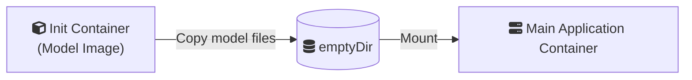
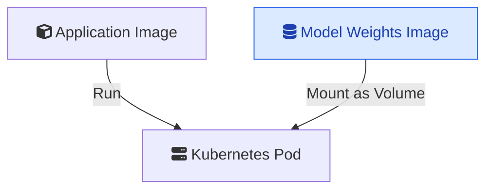
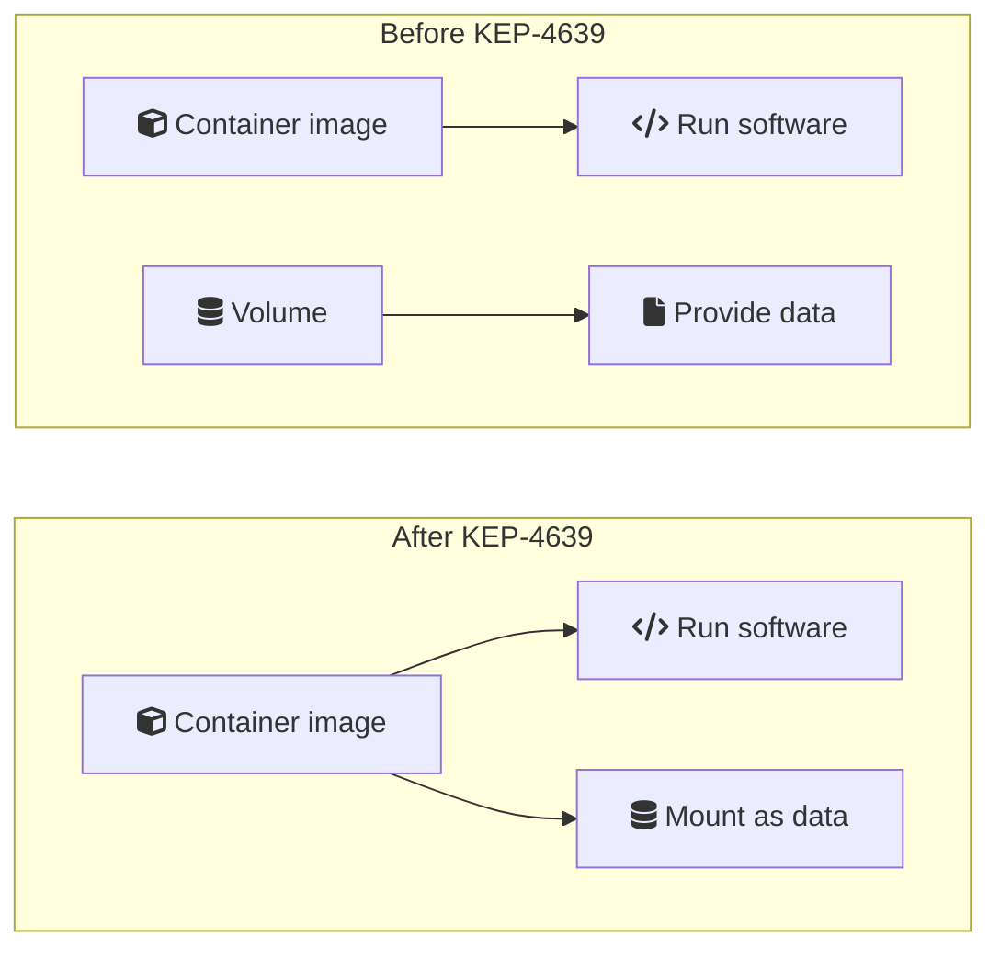
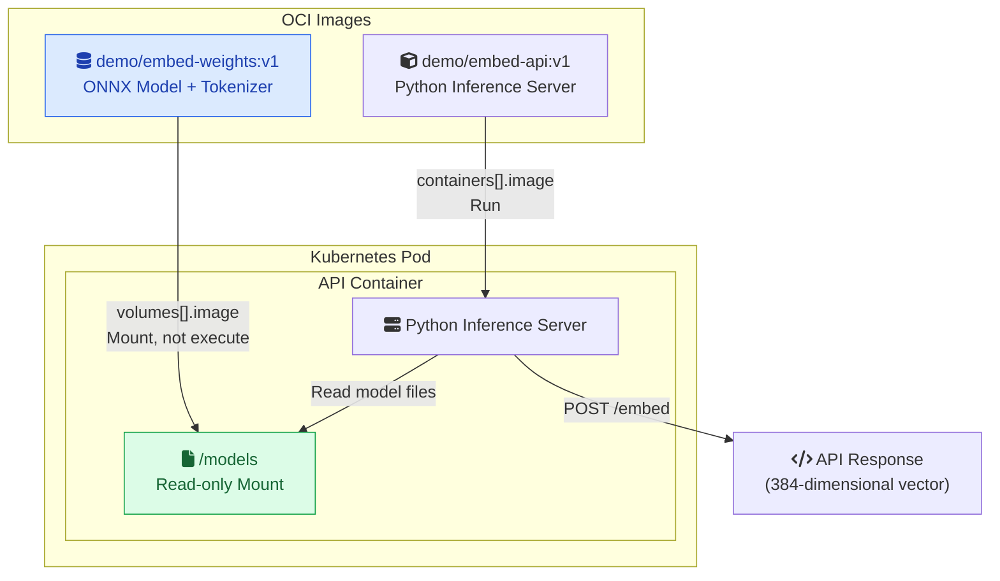

Before the AI era, Kubernetes engineers mostly dealt with traditional workloads like web applications, APIs, and background services. But with the rise of AI, we now face new challenges, especially when running large language model (LLM) inference workloads inside Kubernetes clusters.

One of these challenges is **managing and distributing large model files**.

Kubernetes OCI Image Volumes ([KEP-4639](https://github.com/kubernetes/enhancements/tree/master/keps/sig-node/4639-oci-volume-source)) address part of this problem by allowing us to mount OCI images directly as volumes.


Kubernetes OCI Image Volumes (KEP-4639) let you mount an OCI image as a **read-only directory** inside a container instead of running it.

- Package model weights separately from application code, so you can version and distribute them independently.
- Mount the model image with `volumes[].image` and access its files through a standard `volumeMounts` entry.
- Reuse the existing image registry and node-level image cache without an init container or a PVC for immutable model files.



## The Problem

Imagine you have an application that serves a large AI model.

The application needs two main things:

- **Application code:** For example, a Python inference server, usually relatively small.
- **Model files:** Model weights, which can range from a few GB to hundreds of GB or more.

Traditionally, we had three common approaches to handling this.


Inference is the process of using a trained AI model to make predictions or generate outputs from new inputs.
During inference, the model uses its learned weights without training or updating them.
For example, an LLM generates text from a prompt, while an embedding model converts text into numerical vectors.



Model weights are numerical parameters that represent what a model has learned during training. These values determine how the model processes inputs and generates outputs. Depending on the model, these files can be very large.

https://notes.nimendra.online/00.fleeting-notes/ai-llm/others/model-weight



### Approach A: Put Everything in One Container Image

The simplest approach is to package the application code and model weights together.


The problem is that the application image becomes huge. Updating the model may require rebuilding and distributing the entire application image, even when the application code hasn't changed.

Handling such large images also introduces additional storage and image distribution challenges.

### Approach B: Use an Init Container and emptyDir

Another approach is to use an init container to copy or download model files into a shared `emptyDir` volume before the main application starts.



This works, but it requires additional setup, including an init container, copy commands, and extra storage for the copied files.

### Approach C: Use a PersistentVolume

We can also store model files on persistent storage such as a PVC backed by NFS or another storage system.

This is useful when we need shared or persistent storage, but it introduces additional storage infrastructure that might be unnecessary for immutable model files.

## KEP-4639: A New Approach

KEP-4639 introduces a new Kubernetes volume source called "[image](https://kubespec.dev/kubernetes/v1.36/v1/Pod)".

Instead of copying files from another container or mounting a PVC, **Kubernetes can use an OCI image and expose its contents directly as a read-only directory inside a container.**



The difference is simple:

- `containers[].image` tells Kubernetes **what software to run**.
- `volumes[].image` tells Kubernetes **what packaged files (e.g: Model Weights) to mount**.

This means we can build two separate images: one containing our inference server and another containing only the model weights.

The feature became stable in **[Kubernetes v1.36](https://github.com/kubernetes/kubernetes/blob/master/CHANGELOG/CHANGELOG-1.36.md)**.

### Under the hood

1. Kubelet notices that the Pod has an `image` volume.
2. It asks the container runtime to pull the OCI image using the existing CRI `PullImage` API.
3. The runtime downloads the image layers and prepares the image filesystem.
4. Kubelet passes the image reference to the runtime through the CRI `CreateContainer` request using the `Mount.image` field.
5. The container runtime mounts the image filesystem at the requested path.
6. Kubernetes manages image caching and garbage collection, taking images still in use into account.

> One of the main design decisions behind this KEP is to _reuse the existing container image infrastructure instead of introducing another storage system._

### Comparison With Other Volume Types

| Volume Type             | Best Use Case                                                | Writable                 |
| ----------------------- | ------------------------------------------------------------ | ------------------------ |
| `configMap`             | Small configuration files                                    | No, from the container   |
| `secret`                | Credentials and sensitive data                               | No, from the container   |
| `emptyDir`              | Temporary files and scratch space                            | Yes                      |
| `persistentVolumeClaim` | Persistent application data                                  | Depends on configuration |
| `image` (KEP-4639)      | Versioned, immutable data distributed through OCI registries | No                       |

### Limitations

There are a few things to keep in mind:

- **Read-only:** Containers cannot modify mounted image volumes. Use `emptyDir` or a PVC if writable storage is required.
- **No dynamic updates:** Changing an image tag doesn't update the volume inside an existing Pod. The Pod must be recreated.
- **Startup overhead:** Large images must be downloaded and prepared before containers can start.
- **Runtime support:** The container runtime must support OCI image volume mounts.

We can summarize the change with the following diagram:



## Let's Try This Hands-On

To understand this better, I tested OCI Image Volumes locally using a **kind Kubernetes cluster** and a lightweight embedding model.

To create a local kind cluster with Terraform, see my [kind-cluster-terraform repository](https://github.com/nmdra/kind-cluster-terraform).

The demo code is available in my [k8s-oci-image-volume-demo repository](https://github.com/nmdra/k8s-oci-image-volume-demo).

For this experiment, I used:

- **Kubernetes:** v1.36.1
- **Container runtime:** containerd v2.3.1
- **Embedding model:** `BAAI/bge-small-en-v1.5`
- **Inference library:** FastEmbed

The idea is to package the embedding server and model weights into two independent OCI images.



### 1. Build and Load the Images

I created two Docker images: `embed-api:v1` containing the Python API and `embed-weights:v1` containing the ONNX model and tokenizer files.

```bash
docker build -t demo/embed-api:v1 ./api
docker build -t demo/embed-weights:v1 ./weights
```

Since I'm using kind, I can load these images directly into the cluster without pushing them to a registry.

```bash
kind load docker-image \
  demo/embed-api:v1 \
  demo/embed-weights:v1 \
  --name sunny-zebra
```

### 2. Mount the Model Weights Image

The interesting part is the Kubernetes Deployment configuration:

```yaml
containers:
  - name: api
    # Image containing the Python inference server
    image: demo/embed-api:v1
    imagePullPolicy: Never

    # Standard Kubernetes volumeMounts mechanism
    volumeMounts:
      - name: model-weights
        mountPath: /models
        readOnly: true

volumes:
  - name: model-weights
    # NEW: OCI image used as a volume source (KEP-4639)
    image:
      # Separate image containing only model weights
      # This image is mounted, NOT executed
      reference: demo/embed-weights:v1

      # Use the image already loaded into the kind node
      pullPolicy: Never
```


This example uses `pullPolicy: Never` because both images are preloaded into kind using `kind load docker-image`. For registry-hosted images, use `IfNotPresent` or `Always` as appropriate. Note that `imagePullPolicy` applies to container images, while `pullPolicy` applies to OCI image volumes.


Here, `demo/embed-weights:v1` isn't executed as a container. Instead, Kubernetes mounts its filesystem at `/models`.

After applying the Deployment, I verified the volume using: `kubectl describe pod <pod-name>`

The output confirmed:



I also checked that the model files were available inside the container:

```bash
kubectl exec deployment/embedding-api -- ls -lh /models
```



The model files are mounted and ready to use.

### 3. Test the Embedding API

Next, I forwarded the API port:

```bash
kubectl port-forward deployment/embedding-api 8000:8000
```

And sent a request:

```bash
curl -s http://localhost:8000/embed \
  -H "Content-Type: application/json" \
  -d '{"text":"Hello Kubernetes OCI Image Volumes"}' \
  | jq '{dimensions, first_8: .embedding[:8]}'
```



### 4. Reuse the Same Model Image Across Multiple Pods

One more interesting thing: multiple Pods can use the same model weights image.

```bash
kubectl scale deployment/embedding-api --replicas=3
kubectl get pods -o wide
```

All three Pods reference the same `demo/embed-weights:v1` image.

When multiple Pods run on the same node, containerd can reuse the locally cached image layers. If they run on different nodes, each node needs its own copy.

This avoids rebuilding the model weights into each application image, although each inference server still loads its own model into memory.

## Final Thoughts

OCI Image Volumes provide a simple way to package and distribute immutable data using infrastructure Kubernetes already understands.

For AI workloads, this means we can **version, distribute, and update model weights independently of the inference server**.

Although this article uses an AI workload as an example, **OCI Image Volumes are not limited to mounting model weights**. The [user stories in KEP-4639](https://github.com/kubernetes/enhancements/blob/master/keps/sig-node/4639-oci-volume-source/README.md#user-stories-optional) describe other use cases:

- **Shared configuration:** Package configuration files in an OCI image and mount them into multiple containers in a Pod without including them in each application image.
- **CI/CD artifacts:** Distribute binary artifacts separately and mount them into Pods while maintaining a small set of base images.
- **Malware signatures:** Mount private signature files into a public malware-scanner image without building a combined image.

The broader idea is to **separate the software that runs from the immutable files it consumes**.

---

### References

- [KEP-4639: OCI Volume Source](https://github.com/kubernetes/enhancements/tree/master/keps/sig-node/4639-oci-volume-source)
- [Kubernetes Documentation: Image Volumes](https://kubernetes.io/docs/concepts/storage/volumes/#image)
- [kind Documentation](https://kind.sigs.k8s.io/docs/user/quick-start/)
- [FastEmbed](https://github.com/qdrant/fastembed)
