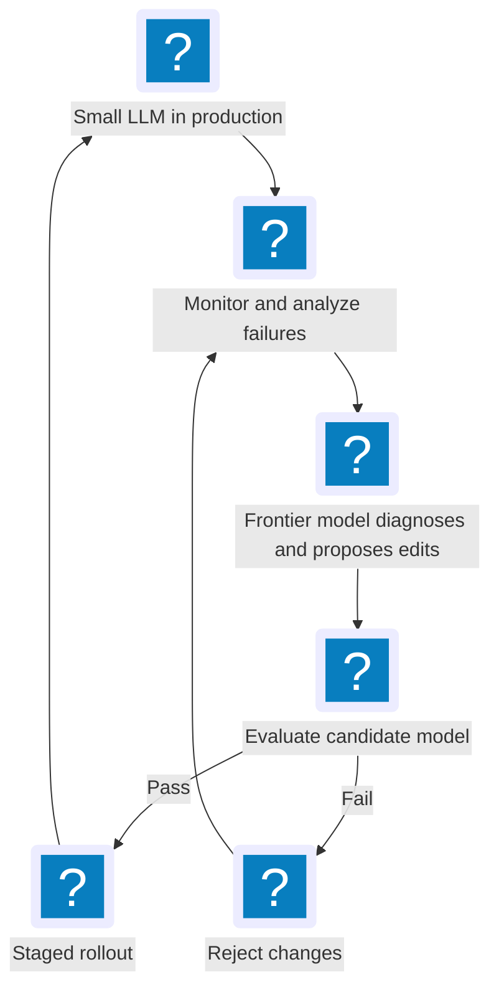

I recently came across [_Sparks of Weight-Space Programming_](https://rikiyat.github.io/blog/weight-space-programming/), and one experiment caught my attention.

The researchers used a frontier reasoning model to modify just **0.016% of Qwen3.5-0.8B's weights**. They reported that its MATH-500 accuracy increased from **7.9% to 48.1%**, without gradient-based training.

The interesting part is _why_ it improved. The model was frequently getting stuck in repetitive reasoning loops. The targeted edits helped it complete more answers, rather than demonstrating that it had learned entirely new mathematical skills.

That got me thinking about a practical use case.

## A Frontier Model as a Model Engineer

Imagine an organization running an open-weight LLM for internal tasks—maybe a 7B model, or a 35B model for more demanding workflows—adapted with RAG and fine-tuning. It's cheaper to serve than calling a frontier model for every request, but it may still have recurring problems: reasoning loops, formatting mistakes, or other consistent failures.

One option is to collect more data and fine-tune again.

But what if a frontier model could act as an **AI model engineer** instead? It could investigate a recurring failure, inspect the smaller model's weights and activations, and propose a targeted fix.

Imagine a feedback loop like this:

The smaller model would handle everyday requests. We'd bring in the more expensive frontier model only when there was a specific issue to investigate. Any proposed edit would need regression tests, safety checks, and a rollback path before deployment.

## Still an Experiment

This is early research, not a proven production workflow. The reported Qwen experiment involved a **0.8B-parameter model**; it doesn't show that targeted weight edits will work reliably on 7B or 35B models, or across arbitrary failures.

And **fixing a broken behavior isn't the same as adding a missing capability**. If a model lacks domain knowledge or a fundamental skill, fine-tuning or retrieval may still be the better approach. We also don't yet know whether targeted weight editing is more cost-effective or reliable than fine-tuning in real applications.

What interests me most isn't the benchmark improvement itself. It's the possibility of separating the model that **does the work** from the model that **improves the worker**.

Instead of making every model bigger, maybe we can use larger models to make smaller ones better.

**Sources:** [Sparks of Weight-Space Programming](https://rikiyat.github.io/blog/weight-space-programming/) · [Experimental code and logs](https://github.com/RikiyaT/lm_understand-logs)
