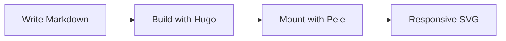
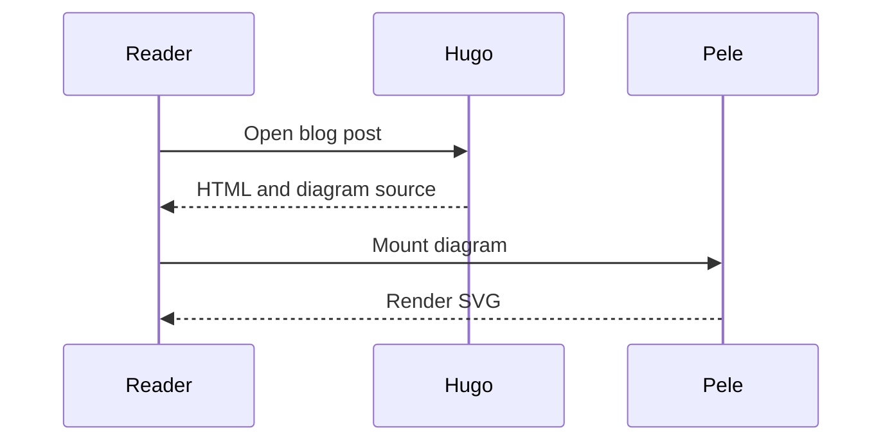
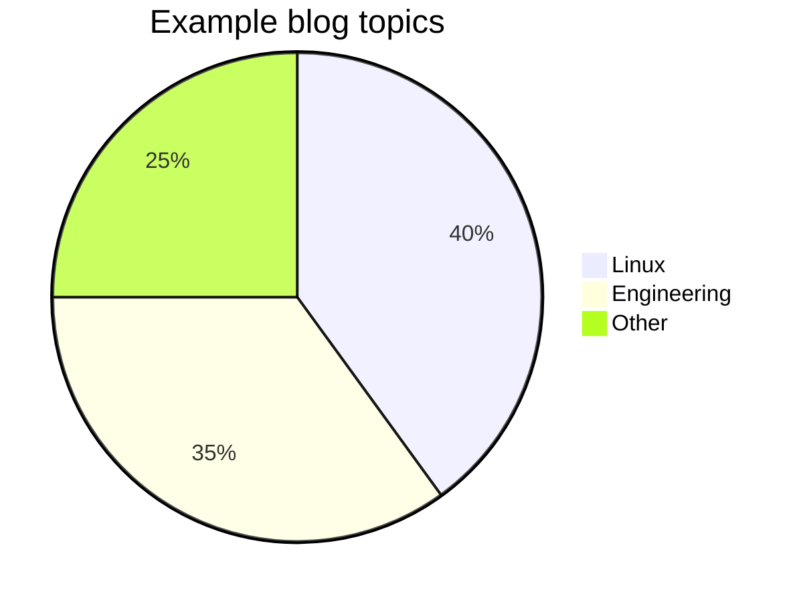

While scrolling through my X feed, I saw [kepano](https://x.com/kepano) announce a new Mermaid rendering library called [Pele](https://github.com/obsidianmd/pele).

I wanted to give it a try because of its minimal look, support for smaller screens, and theming. The diagrams also looked more beautiful to me than the Mermaid renders I was using on this blog.

```mermaid
---
config:
  flowchart:
    nodeSpacing: 24
    rankSpacing: 50
---
flowchart LR
    accTitle: Pele meets Hugo
    accDescr: Pele is the Mermaid renderer for this Hugo blog, with responsive layouts, theme colors, and zoom.
    pele@{ img: "/images/pele-home.svg", label: "Pele", pos: "b", w: 108, h: 81, constraint: "on" }
    hugo@{ img: "/images/hugo-logo.png", label: "Hugo", pos: "b", w: 80, h: 80, constraint: "on" }
    pele ==>|Mermaid renderer for| hugo
    hugo -.->|resize| mobile(["Adaptive<br/>layouts"])
    hugo -.->|recolor| theme(["Latte/<br/>Mocha"])
    hugo -.->|explore| zoom(["Zoom<br/>+ pan"])
    click pele "https://pele.run/" "Visit Pele"
    click hugo "https://gohugo.io/" "Visit Hugo"

    caption["Pele meets Hugo. Click either logo to visit the project, or switch the blog theme to see the diagram colors change."]

    classDef captionStyle fill:transparent,stroke:transparent,color:inherit,font-size:10px,font-style:italic;
    class caption captionStyle;
```

Here are the small changes I made to switch my Hugo blog from Mermaid's renderer to Pele. I kept the same `mermaid` code fences in Markdown. _The renderer changed, not the way I write diagrams._

## The Hugo changes

My blog uses PaperMod Theme. I already had a [Mermaid render hook](https://gohugo.io/content-management/diagrams/#mermaid-diagrams) and a footer script that loaded Mermaid in the browser. I replaced that script with Pele, without adding an npm build step.

### Pin the browser module

In `config.yml`, I replaced `mermaidUrl` with:

```yaml
params:
  peleUrl: "https://cdn.jsdelivr.net/npm/pele@1.9.0/dist/pele.js"
```

This goes inside the existing `params` section.

### Keep the source as text

My `layouts/_markup/render-codeblock-mermaid.html` now contains:

```go-html-template
{{- $diagram := .Inner | strings.TrimSpace -}}
<div class="mermaid"><pre class="mermaid-source">{{ $diagram | htmlEscape | safeHTML }}</pre></div>
```

The escaping matters for labels containing things like `<br/>` or `&`. The browser must not interpret the diagram source as HTML before Pele reads it. The `<pre>` also leaves readable source when JavaScript is unavailable.

### Replace the Mermaid loader

In `layouts/partials/extend_footer.html`, I removed the Mermaid initialization and added:

```go-html-template
<script id="pele-loader" type="module" data-url="{{ site.Params.peleUrl }}">
  const diagrams = document.querySelectorAll(".mermaid");
  if (diagrams.length) {
    try {
      const loader = document.querySelector("#pele-loader");
      const { mount } = await import(loader.dataset.url);
      for (const element of diagrams) {
        mount(element, element.textContent, {
          links: true,
          images: true,
          zoom: true
        });
      }
    } catch (error) {
      console.error("Unable to load Pele diagrams.", error);
      for (const element of diagrams) {
        const message = document.createElement("p");
        message.className = "mermaid-error";
        message.setAttribute("role", "status");
        message.textContent = "Diagram rendering is unavailable. Source is shown below.";
        element.prepend(message);
      }
    }
  }
</script>
```

Pages without diagrams do not download Pele. For pages with diagrams, `mount()` reads the source, renders SVG, and updates the layout when the container width changes.

I enabled links and images inside diagrams. `zoom: true` enables zoom even when a diagram already fits. Pele's default, `zoom: "auto"`, only enables it when the diagram shrinks to fit.

## Match the blog theme

This blog uses Catppuccin Latte and Mocha. Pele uses CSS variables, so I connected its colors to the variables PaperMod already uses.

This is the core of `assets/css/extended/mermaid.css`:

```css
.mermaid {
  margin: 1.5rem 0;
  min-width: 0;
  --pele-bg: var(--theme);
  --pele-fg: var(--content);
  --pele-muted: var(--secondary);
  --pele-line: var(--primary);
  --pele-surface: var(--entry);
  --pele-surface-alt: var(--tertiary);
  --pele-border: var(--border);
  --pele-accent: #8839ef;
  --pele-error: #d20f39;
}

:root[data-theme="dark"] .mermaid,
.dark .mermaid {
  --pele-accent: #cba6f7;
  --pele-error: #f38ba8;
}

.mermaid svg.pele {
  display: block;
  margin-inline: auto;
}

.mermaid .mermaid-source {
  max-width: 100%;
  overflow-x: auto;
}

.mermaid .mermaid-error {
  color: var(--pele-error);
}
```

I also set `--pele-series-1` through `--pele-series-8` for chart colors. The [full CSS file](https://github.com/nmdra/nmdra.github.io/blob/main/assets/css/extended/mermaid.css) has both palettes.

Switching the blog theme now changes diagram colors without re-rendering the SVG.

## A few examples

These diagrams are rendered by Pele on this page. Try the theme button and a narrower window to see how they behave.

### Flowchart

I still write a normal Mermaid fence:

````markdown

````

And this is the result:


On narrow screens, supported layouts can change direction. This horizontal flowchart can become vertical instead of shrinking all its labels.

### Sequence diagram



With zoom enabled, double-click or use Ctrl/Command + mouse wheel to zoom in. Drag the zoomed diagram to pan, then use the reset control to fit it again.

### Pie chart



---

> For more details on the Pele integration, check out [this commit](https://github.com/nmdra/nmdra.github.io/commit/05cc4997b64901342bce5798fa45a65b74255ebd).

Links:

- [Pele on GitHub](https://github.com/obsidianmd/pele)
- Artwork sources: [Pele](https://pele.run/pele-home.svg) and [Hugo](https://github.com/gohugoio/hugoDocs/blob/master/assets/images/logos/logo-128x128.png)
- [API and mounting options](https://pele.run/api)
- [Theming](https://pele.run/theming)
- [Compatibility](https://pele.run/compatibility)
- [More diagram examples](https://pele.run/examples)
