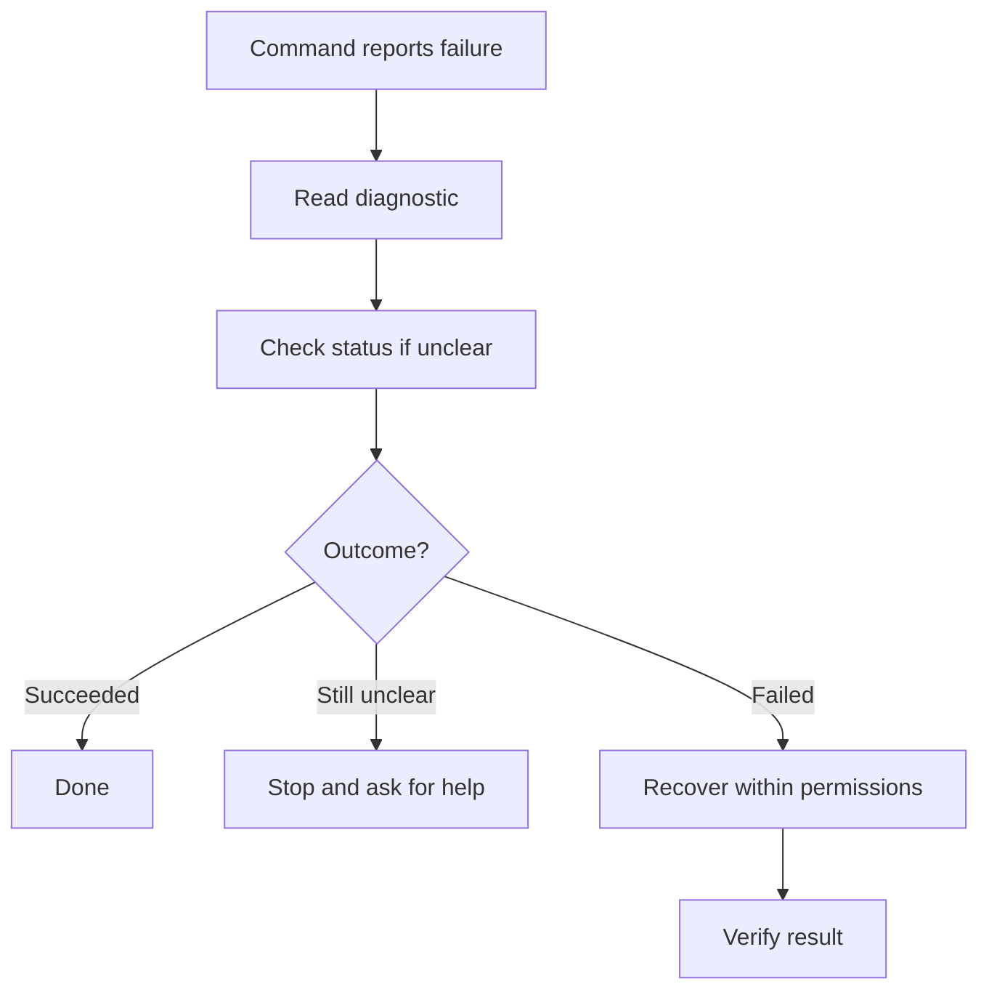

I've been thinking about the CLI commands we give AI coding agents and the guidance they get when something goes wrong. **Are we designing our developer tools with AI agents in mind?**

Skills can explain a workflow, but when a command fails, the CLI should help the agent understand why and choose a safe next step.



Take a deployment command that returns this:

```text
$ acme deploy --env staging

Error: DEPLOY_042
Deployment failed.
```

Now the agent has to find out what `DEPLOY_042` means. It might open the documentation, inspect logs, check credentials, or retry the command with different flags.

A developer can draw on experience with the tool or the system to understand what the error means. But when an agent has to discover context that the tool already knows, each extra step adds tool calls, tokens, and execution time. A wrong guess can also lead to an inappropriate fix.


For well-known tools, an agent may already recognize common errors from documentation and examples encountered during training. It may be able to choose a useful next step without much investigation. Custom or internal developer tools are different: their commands, error codes, and recovery procedures may never have appeared in the model's training data. The CLI's own output becomes much more important.


Even with familiar tools, that knowledge can be outdated or miss details specific to the current environment.

## Give the Agent a Useful Next Step

An agent needs to distinguish between failures that look similar but need different fixes. Is the configuration invalid? Does the active account lack permission? Is the service temporarily unavailable? Or did the request time out after the deployment had already started?

Retrying might help with one, do nothing for another, and create duplicate work for a third.

For a permission failure, the CLI could report:

- The operation failed during authorization.
- The active account lacks `deploy:create` permission in `staging`.
- No deployment was created.
- The agent can check the active identity with `acme auth whoami`.
- Deployment access requires approval from an administrator.

Returning what the tool already knows would let the agent investigate the specific failure instead of reconstructing it from a generic error code.

The CLI should also distinguish facts from guesses. If it cannot confirm whether a deployment started, it should say the outcome is unknown and suggest checking deployment status before retrying.

I'd want the recovery process to look something like this:



If the deployment already succeeded, there's no need to retry. If its status remains unclear or recovery needs extra permissions, stop and ask for help. Retry only when it's safe.

## A Small Example From [NoteBrain](https://github.com/nmdra/notebrain-cli)

I've started applying a small part of this idea in [NoteBrain](https://github.com/nmdra/notebrain-cli), my CLI for searching and retrieving notes from an Obsidian vault, a local collection of Markdown files.

Suppose an agent tries to search, but the local embedding model isn't available. A generic message like this gives it little to work with:

```text
Model initialization failed.
```

The actual error identifies missing files or a download lock. For missing files, it points the agent to `notebrain doctor`. Here are three recovery messages from that command, with terminal styling omitted:

```text
Missing model files:
[!] ONNX model recovery: run `notebrain doctor --fix` to download and restore the missing files, then rerun doctor

Active download lock:
[!] ONNX model recovery: wait for the active download; do not remove its lock

Stale download lock:
[!] ONNX model recovery: confirm the recorded PID is not running, then remove the stale lock and restore the model files
```

The guidance also tells the agent when to leave things alone. An active download is a reason to wait, rather than remove a lock or start another repair.

See the [`doctor` implementation](https://github.com/nmdra/notebrain-cli/blob/master/cmd/doctor.go) for the recovery messages.

## Taking It Further With Structured Diagnostics

I'd call the broader approach *agent-readable CLI diagnostics*: a stable, structured description of the failure, the relevant context, and possible recovery steps.

Here's how the earlier deployment permission failure could look with `--output json`:

```json
{
  "schema_version": "1.0",
  "success": false,
  "error": {
    "code": "DEPLOY_PERMISSION_DENIED",
    "stage": "authorization",
    "message": "The active account lacks deploy:create permission in staging.",
    "required_permission": "deploy:create",
    "environment": "staging",
    "deployment_created": false,
    "retryable": false,
    "retry_condition": "Deployment permission must change before retrying.",
    "suggested_checks": [
      {
        "argv": ["acme", "auth", "whoami"],
        "purpose": "Verify the active account.",
        "read_only": true
      }
    ],
    "next_action": "Request staging deployment access from an administrator.",
    "docs_url": "https://docs.example.com/deploy/permissions",
    "trace_id": "example-trace-042"
  }
}
```


The `acme` CLI and JSON schema above are hypothetical examples of how structured recovery guidance could work. They are not NoteBrain's current output or a proposed standard.


The agent can now check whether it is using the intended account. If the account is correct, it has a reason to stop and ask for access rather than repeatedly attempting the deployment.

Here, `retryable: false` means retrying won't help until the permissions change.

A trace ID can help locate the underlying request in logs, and a documentation link can explain the failure in more detail. Neither should replace the immediate failure context.

## Wouldn't This Make CLI Output Messy?

> Yes, it's messy for a human. for agents it's a context (guideline / hint) though.

I'd keep the default human-readable output short:

```text
Deployment denied: the active account lacks deploy:create in staging.
Check the active account: acme auth whoami
Request staging deployment access if the account is correct.
```

Then offer structured output through `--output json`, with deeper logs available on demand. An `--explain` option could provide more detail for either audience.

In JSON mode, the CLI should document which stream carries diagnostics, keep progress messages out of that stream, and return a nonzero exit status on failure.

More output also consumes context. A stack trace, a full configuration dump, and ten possible fixes may make the agent's job harder. Return the facts needed for the next decision, then let the consumer request more detail.

## Suggestions Are Not Permission


A suggested command should never become automatic authorization to execute it. Even a read-only identity check can expose account information. A suggested fix might change permissions, delete state, or restart a production service. The agent's execution policy and the user's approval must still control those actions.


I'd use argument arrays rather than shell command strings for suggested checks. That avoids shell parsing, though the consumer still needs to validate the arguments. External text in diagnostics should remain data, not instructions the agent is expected to obey.

The CLI must also redact secrets and avoid dumping sensitive request bodies. For an access failure, recommending that an agent disable authorization or grant itself broader permissions would be a dangerous recovery path. Sometimes the correct next step is to stop and ask a person.

## There Are Useful Foundations Already

[SWE-agent](https://proceedings.neurips.cc/paper_files/paper/2024/hash/5a7c947568c1b1328ccc5230172e1e7c-Abstract-Conference.html) studies interfaces designed for language-model agents doing software engineering. Anthropic's [Writing effective tools for agents](https://www.anthropic.com/engineering/writing-tools-for-agents) specifically recommends actionable error feedback and token-efficient responses.

The [Rust compiler's JSON diagnostics](https://doc.rust-lang.org/rustc/json.html) already include error codes, source locations, and suggestions. [RFC 9457](https://www.rfc-editor.org/rfc/rfc9457.html) defines structured problem details for HTTP APIs. It isn't a CLI standard, but it provides a useful design reference.

These sources support the design direction. They don't establish that the proposed CLI diagnostics improve agent recovery.

I'd like to see recovery guidance become a normal part of CLI design, especially for custom and internal tools. We already explain how to run a command. Helping an agent understand a failed result deserves the same attention.

## References

- [Agent-Friendly Interactive CLIs](https://notes.nimendra.online/00.fleeting-notes/ai-llm/conference/agent-friendly-interactive-clis)
