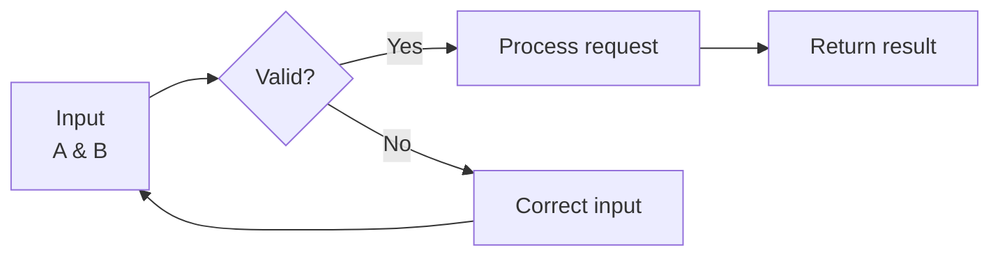
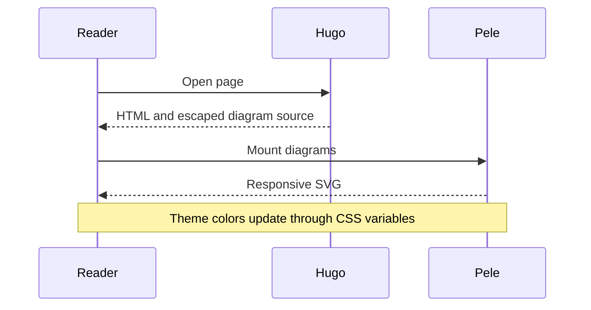
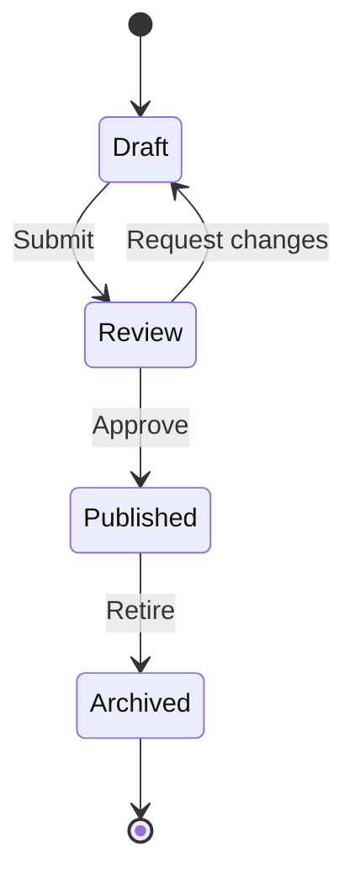
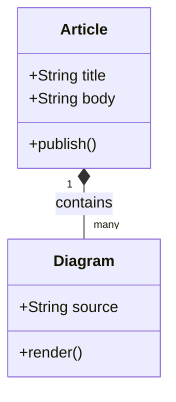
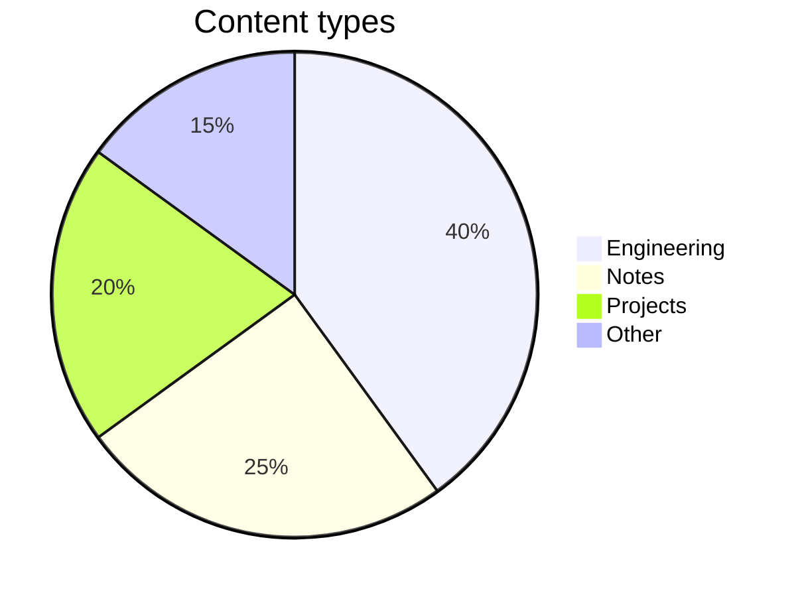
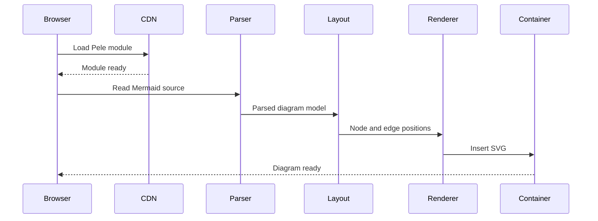

This draft page tests Pele with Mermaid code fences. It is excluded from normal production builds.

## Manual checklist

- Use the theme button beside the site title. Check that text, nodes, edges, and chart colors change in both directions.
- Reduce the window to a phone width. Check that labels remain readable and the page does not scroll sideways.
- Check that the flowchart label shows **Input** and **A & B** on separate lines, not raw HTML.
- Use the wide sequence diagram to test zoom and pan when it shrinks to fit. Use the zoom controls, double-click, or Ctrl/Command + mouse wheel.
- Check that every diagram renders independently. The last example is intentionally invalid and should show an error.
- To test the source fallback, disable JavaScript or block `https://cdn.jsdelivr.net/npm/pele@1.9.0/dist/pele.js` in browser developer tools, then reload. Source should remain readable without widening the page.

Diagram links and images are enabled in this integration. Referenced external images can make network requests.

## Flowchart and multiline labels

This horizontal flowchart can switch to a vertical layout on narrow screens.



## Sequence diagram



## State diagram



## Class diagram



## Chart palette

Check the slice and legend colors in both themes.



## Wide diagram and zoom

At phone width, this sequence diagram should shrink to fit. If zoom controls appear, zoom in and drag to inspect the details. Reset the zoom to see the full diagram again.



## Expected error

The next block is intentionally invalid. It should show a readable error without preventing the diagrams above from rendering. The HTML-like text must not become an image or run JavaScript.

```mermaid
not-a-diagram 
```
